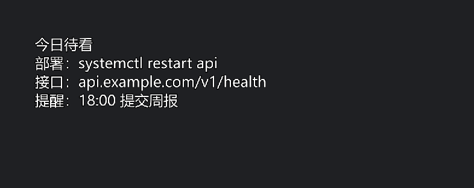
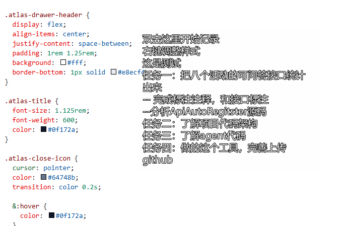
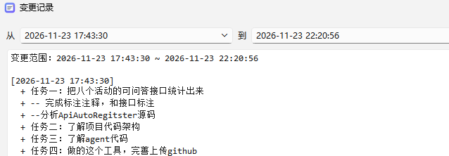

# FloatNote 悬浮便签

多智能体（或多个会话）并行干活时，经常一转头就忘了。这个文件是谁改的？刚才那个 agent 做到哪一步？下一步该谁接手？

FloatNote 是一个常驻桌面的透明悬浮记事本。像桌面歌词一样浮在编辑器和浏览器上，把「谁在做什么、做到哪了」随手记下来，抬眼就能看到，省去切窗口翻聊天记录的来回。



## 为什么要做成透明的

写代码时，便签常常就放在正在看的窗口上。FloatNote 在阅读时只显示文字和描边，眼睛扫过便签，也能继续看下面的代码。想补一句，双击就能在原地编辑。



## 功能

- 随手记下 agent 分工、进度和待接手的工作
- 无边框置顶，文字颜色、描边、字号、透明度和宽度都可调整
- 便签内可以拖动和双击，位置和外观会记住
- 全局快捷键随时收起或叫回便签，可在设置中改键
- Windows 托盘和 macOS 菜单栏可以打开设置、重启和退出
- 内容长到超过屏幕可用高度的 80% 时，可在便签里滚动
- 正文与历史保存在本机。装有 Git 时，可以按时间段查看和复制修改记录

## 快速开始

从 [GitHub Releases](https://github.com/gosleeper/floating-note/releases/latest) 选对应系统和芯片的安装包。

| 电脑 | 下载文件 | 打开方式 |
| --- | --- | --- |
| Windows x64 | `*-setup.exe` | 双击安装，缺少 WebView2 时安装程序会联网安装它 |
| Windows x64 便携版 | `*-portable.exe` | 系统有 WebView2 时，双击即可运行 |
| Apple 芯片 Mac（M 系列） | `*-aarch64.dmg` | 打开 DMG，把 FloatNote 拖到「应用程序」 |
| Intel 芯片 Mac | `*-x64.dmg` | 打开 DMG，把 FloatNote 拖到「应用程序」 |

如果 Mac 首次启动时提示无法验证，可在「系统设置 → 隐私与安全性」中查看「仍要打开」。[Apple 说明](https://support.apple.com/guide/mac-help/open-a-mac-app-from-an-unidentified-developer-mh40616/mac)

## 使用

| 操作 | 行为 |
| --- | --- |
| 左键按住拖动 | 移动便签 |
| 双击 | 进入编辑 |
| Windows `Win+Shift+Q` / macOS `Control+Option+N` | 显示或隐藏便签，可在「快捷键设置」里改 |
| `Esc` / `Ctrl+Enter` / 点到其他窗口 | 保存并结束编辑，macOS 也支持 `Cmd+Enter` |
| 右键 | 打开样式、快捷键、历史、数据导入，或重置位置 |
| Windows 托盘 / macOS 菜单栏 | 显示或隐藏便签，打开设置，重启或退出 |
| 滚轮 | 便签放不下所有内容时滚动 |

## 数据文件与旧版迁移

在「数据与导入」可以看到当前数据目录。全新安装默认使用当前账户的应用数据目录。

| 文件 | 内容 |
| --- | --- |
| `notes.txt` | UTF-8 纯文本备忘 |
| `config.json` | 便签位置、外观和快捷键 |
| `notes-history/` | 本地 Git 历史 |

升级旧便携版时，可以先退出旧程序，再把新的 Windows 便携版 EXE 放进旧数据目录。换机器或改用安装版时，在「数据与导入」选择旧目录，预览并确认后重启。程序会复制正文、配置和历史，方便你保留原目录作为备份。

## 笔记历史与变更记录

装有 Git 时，每次结束编辑并保存改动，FloatNote 会在本地版本历史里记一笔。右键选择「查看变更记录…」，框定起止时间，就能看到那段时间里加了哪些、删了哪些，还可以一键复制。



## 开发

FloatNote 使用 **Tauri 2 + Rust + TypeScript**。准备 Node.js 22.12+、Rust stable 与 [Tauri 的系统构建依赖](https://v2.tauri.app/start/prerequisites/)。

```bash
git clone https://github.com/gosleeper/floating-note.git
cd floating-note
npm ci
npm run tauri dev
```

```bash
npm run build
cargo test --locked --manifest-path src-tauri/Cargo.toml
```

Windows 使用 `npm run tauri build -- --bundles nsis -- --locked` 生成安装包。macOS 使用 `npm run tauri build -- --bundles dmg -- --locked` 生成当前架构的 DMG。开发时可通过 `FLOATNOTE_DATA_DIR` 指定单独的数据目录。

## 项目结构

```text
src/                     # 便签、设置和变更记录界面
src-tauri/src/desktop.rs  # 窗口、托盘和全局快捷键
src-tauri/src/geometry.rs # 窗口尺寸、定位与多显示器
src-tauri/src/storage.rs  # 纯文本、配置、导入和 Git 历史
.github/workflows/       # Windows、Apple Silicon 和 Intel Mac 构建
```
